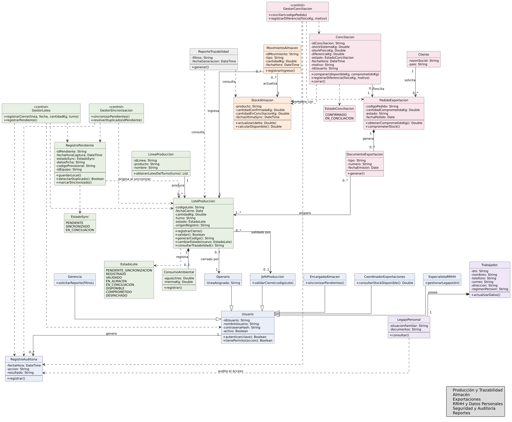
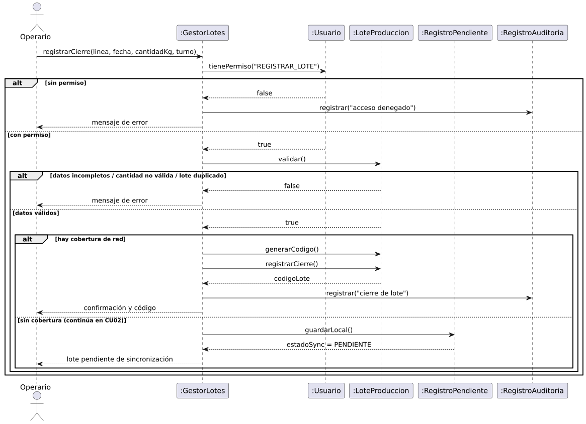
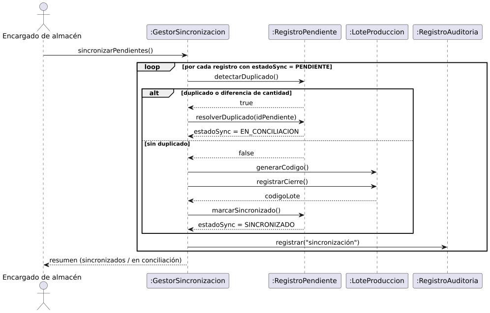
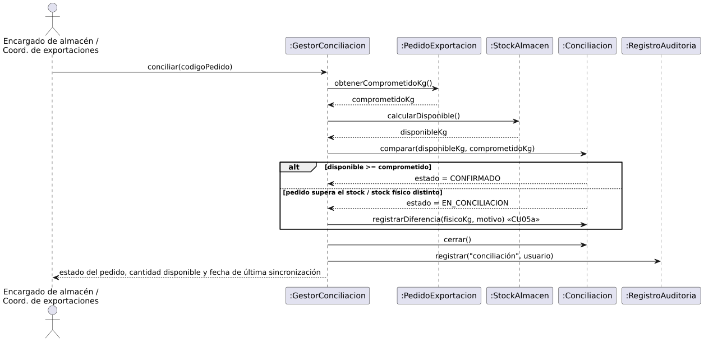
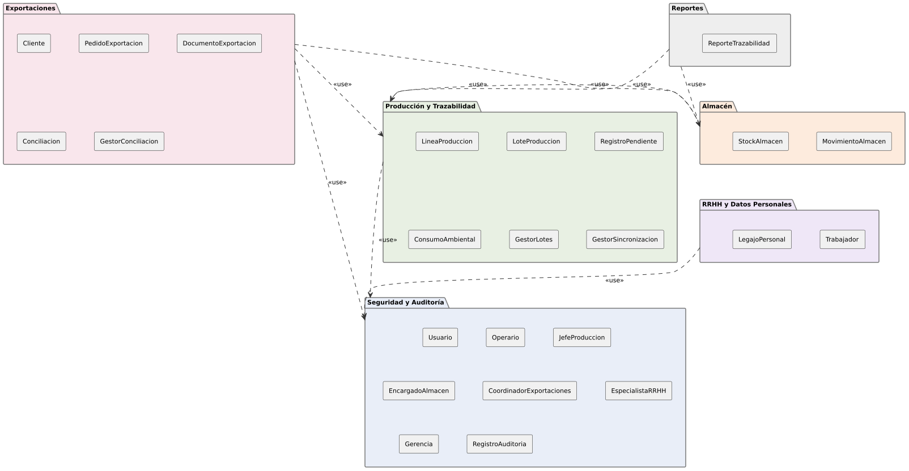
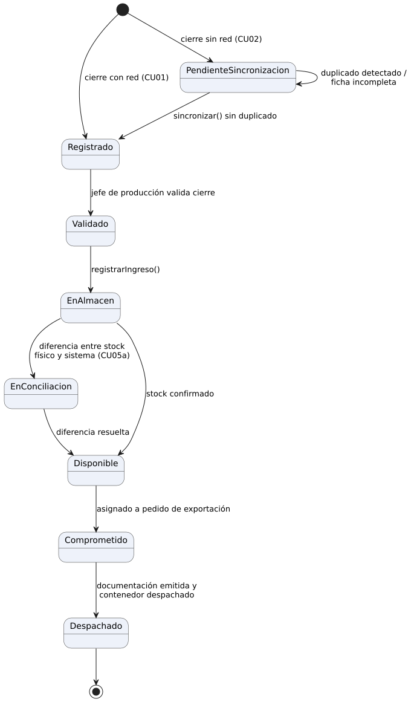

UNIVERSIDAD PRIVADA DEL NORTE

Modelado y Desarrollo de Aplicaciones · CIIN1322P

  
  

# GUÍA DE LABORATORIO — TEMA N.° 5

**Modelo conceptual: diagrama de clases UML y trazas requisito–clase**

Caso de estudio: AgroVerde S.A.C.

  

| Integrantes                       | Código UPN |
|-----------------------------------|------------|
| Pablo Marcelino Blas Campomanes   | N00493608  |
| David Ruiz Pérez                  | N00469228  |
| Dayron Michelle Yangali Machado   | N00470550  |
| Orlando Valentino Ravenna Soriano | N00488189  |

Docente: Jorge Luis Cordova Lopez

Versión del entregable: v1.0-lab5 (modelo v0.5) · Fecha: 01/11/2026

Repositorio: <https://github.com/Orlando123-cmd/agroverde-labs> (tag v1.0-lab5)

# 1. Objetivo

Construir y refinar el diagrama de clases UML de AgroVerde S.A.C. a partir de los requisitos (Lab. 2), los casos de uso (Lab. 3) y las historias de usuario (Lab. 4), aplicando alta cohesión y bajo acoplamiento, y demostrar la trazabilidad requisito–clase con diagramas de secuencia, de paquetes y de estados que confirmen las responsabilidades de cada clase.

El punto de partida es el modelo de análisis del Avance 5 (v0.4, 23 clases). Este laboratorio lo contrasta con las secuencias y con los Labs. 3 y 4, lo refactoriza y entrega el **modelo v0.5** con 24 clases, 3 enumeraciones y 34 relaciones.

# 2. Procedimiento

## Paso 1. Entidades y responsabilidades candidatas

| Fuente                               | Entidades / responsabilidades candidatas                                                                                       | Clases resultantes                                                |
|--------------------------------------|--------------------------------------------------------------------------------------------------------------------------------|-------------------------------------------------------------------|
| Casos de uso CU01–CU09, CU05a        | Lote, línea, registro sin red, stock, movimiento, pedido, cliente, documento, conciliación, legajo, reporte, consumo ambiental | 11 «entity» de dominio                                            |
| RF06, RNF02 (datos personales)       | Trabajador y su legajo, con acceso restringido                                                                                 | Trabajador, LegajoPersonal                                        |
| RNF01 y actores de los CU            | Usuario y los 6 roles del sistema; auditoría de accesos                                                                        | Usuario (abstracta), 6 subclases, RegistroAuditoria               |
| Flujos de CU01, CU02 y CU05          | Quién orquesta cada caso de uso                                                                                                | GestorLotes, GestorSincronizacion, GestorConciliacion («control») |
| Estados del Lab. 3 (I-02) y del lote | Estados explícitos de lote, registro pendiente y conciliación                                                                  | EstadoLote, EstadoSync, EstadoConciliacion (enumeraciones)        |

## Paso 2. Clases, atributos y operaciones (modelo v0.5)

Convenciones: clases en PascalCase, atributos y operaciones en camelCase, atributos privados (−) y operaciones públicas (+). Las enumeraciones se listan al final.

### Paquete Producción y Trazabilidad

<table>
<colgroup>
<col style="width: 33%" />
<col style="width: 33%" />
<col style="width: 33%" />
</colgroup>
<thead>
<tr class="header">
<th>Clase</th>
<th>Atributos (privados)</th>
<th>Operaciones (públicas)</th>
</tr>
</thead>
<tbody>
<tr class="odd">
<td><strong>LineaProduccion</strong> 
«entity»</td>
<td>− idLinea: String 
− producto: String 
− nombre: String</td>
<td>+ obtenerLotesDelTurno(turno): List</td>
</tr>
<tr class="even">
<td><strong>LoteProduccion</strong> 
«entity»</td>
<td>− codigoLote: String 
− fechaCierre: Date 
− cantidadKg: Double 
− turno: String 
− estado: EstadoLote 
− origenRegistro: String</td>
<td>+ registrarCierre() 
+ validar(): Boolean 
+ generarCodigo(): String 
+ cambiarEstado(nuevo: EstadoLote) 
+ consultarTrazabilidad(): String</td>
</tr>
<tr class="odd">
<td><strong>RegistroPendiente</strong> 
«entity»</td>
<td>− idPendiente: String 
− fechaHoraCaptura: DateTime 
− estadoSync: EstadoSync 
− datosFicha: String 
− codigoProvisional: String 
− idEquipo: String</td>
<td>+ guardarLocal() 
+ detectarDuplicado(): Boolean 
+ marcarSincronizado()</td>
</tr>
<tr class="even">
<td><strong>ConsumoAmbiental</strong> 
«entity»</td>
<td>− aguaLitros: Double 
− mermaKg: Double</td>
<td>+ registrar()</td>
</tr>
<tr class="odd">
<td><strong>GestorLotes</strong> 
«control»</td>
<td>—</td>
<td>+ registrarCierre(linea, fecha, cantidadKg, turno) 
+ registrarPendiente()</td>
</tr>
<tr class="even">
<td><strong>GestorSincronizacion</strong> 
«control»</td>
<td>—</td>
<td>+ sincronizarPendientes() 
+ resolverDuplicado(idPendiente)</td>
</tr>
</tbody>
</table>

### Paquete Almacén

<table>
<colgroup>
<col style="width: 33%" />
<col style="width: 33%" />
<col style="width: 33%" />
</colgroup>
<thead>
<tr class="header">
<th>Clase</th>
<th>Atributos (privados)</th>
<th>Operaciones (públicas)</th>
</tr>
</thead>
<tbody>
<tr class="odd">
<td><strong>MovimientoAlmacen</strong> 
«entity»</td>
<td>− idMovimiento: String 
− tipo: String 
− cantidadKg: Double 
− fechaHora: DateTime</td>
<td>+ registrarIngreso()</td>
</tr>
<tr class="even">
<td><strong>StockAlmacen</strong> 
«entity»</td>
<td>− producto: String 
− cantidadConfirmadaKg: Double 
− cantidadEnConciliacionKg: Double 
− fechaUltimaSync: DateTime</td>
<td>+ actualizar(delta: Double) 
+ calcularDisponible(): Double</td>
</tr>
</tbody>
</table>

### Paquete Exportaciones

<table>
<colgroup>
<col style="width: 33%" />
<col style="width: 33%" />
<col style="width: 33%" />
</colgroup>
<thead>
<tr class="header">
<th>Clase</th>
<th>Atributos (privados)</th>
<th>Operaciones (públicas)</th>
</tr>
</thead>
<tbody>
<tr class="odd">
<td><strong>Cliente</strong> 
«entity»</td>
<td>− razonSocial: String 
− pais: String</td>
<td>—</td>
</tr>
<tr class="even">
<td><strong>PedidoExportacion</strong> 
«entity»</td>
<td>− codigoPedido: String 
− cantidadComprometidaKg: Double 
− estado: String 
− fechaPedido: Date</td>
<td>+ obtenerComprometidoKg(): Double 
+ comprometerStock()</td>
</tr>
<tr class="odd">
<td><strong>DocumentoExportacion</strong> 
«entity»</td>
<td>− tipo: String 
− numero: String 
− fechaEmision: Date</td>
<td>+ generar()</td>
</tr>
<tr class="even">
<td><strong>Conciliacion</strong> 
«entity»</td>
<td>− idConciliacion: String 
− stockSistemaKg: Double 
− stockFisicoKg: Double 
− diferenciaKg: Double 
− estado: EstadoConciliacion 
− fechaHora: DateTime 
− motivo: String 
− idUsuario: String</td>
<td>+ comparar(disponibleKg, comprometidoKg) 
+ registrarDiferencia(fisicoKg, motivo) 
+ cerrar()</td>
</tr>
<tr class="odd">
<td><strong>GestorConciliacion</strong> 
«control»</td>
<td>—</td>
<td>+ conciliar(codigoPedido) 
+ registrarDiferencia(fisicoKg, motivo)</td>
</tr>
</tbody>
</table>

### Paquete RRHH y Datos Personales

<table>
<colgroup>
<col style="width: 33%" />
<col style="width: 33%" />
<col style="width: 33%" />
</colgroup>
<thead>
<tr class="header">
<th>Clase</th>
<th>Atributos (privados)</th>
<th>Operaciones (públicas)</th>
</tr>
</thead>
<tbody>
<tr class="odd">
<td><strong>Trabajador</strong> 
«entity»</td>
<td>− dni: String 
− nombres: String 
− telefono: String 
− correo: String 
− direccion: String 
− regimenPension: String</td>
<td>+ actualizarDatos()</td>
</tr>
<tr class="even">
<td><strong>LegajoPersonal</strong> 
«entity»</td>
<td>− situacionFamiliar: String 
− documentos: String</td>
<td>+ consultar()</td>
</tr>
</tbody>
</table>

### Paquete Seguridad y Auditoría

<table>
<colgroup>
<col style="width: 33%" />
<col style="width: 33%" />
<col style="width: 33%" />
</colgroup>
<thead>
<tr class="header">
<th>Clase</th>
<th>Atributos (privados)</th>
<th>Operaciones (públicas)</th>
</tr>
</thead>
<tbody>
<tr class="odd">
<td><strong>Usuario</strong> 
«entity» abstracta</td>
<td>− idUsuario: String 
− nombreUsuario: String 
− contrasenaHash: String 
− activo: Boolean</td>
<td>+ autenticar(clave): Boolean 
+ tienePermiso(accion): Boolean</td>
</tr>
<tr class="even">
<td><strong>Operario</strong> 
«entity»</td>
<td>− lineaAsignada: String</td>
<td>—</td>
</tr>
<tr class="odd">
<td><strong>JefeProduccion</strong> 
«entity»</td>
<td>—</td>
<td>+ validarCierre(codigoLote)</td>
</tr>
<tr class="even">
<td><strong>EncargadoAlmacen</strong> 
«entity»</td>
<td>—</td>
<td>+ sincronizarPendientes()</td>
</tr>
<tr class="odd">
<td><strong>CoordinadorExportaciones</strong> 
«entity»</td>
<td>—</td>
<td>+ consultarStockDisponible(): Double</td>
</tr>
<tr class="even">
<td><strong>EspecialistaRRHH</strong> 
«entity»</td>
<td>—</td>
<td>+ gestionarLegajo(dni)</td>
</tr>
<tr class="odd">
<td><strong>Gerencia</strong> 
«entity»</td>
<td>—</td>
<td>+ solicitarReporte(filtros)</td>
</tr>
<tr class="even">
<td><strong>RegistroAuditoria</strong> 
«entity»</td>
<td>− fechaHora: DateTime 
− accion: String 
− resultado: String</td>
<td>+ registrar()</td>
</tr>
</tbody>
</table>

### Paquete Reportes

<table>
<colgroup>
<col style="width: 33%" />
<col style="width: 33%" />
<col style="width: 33%" />
</colgroup>
<thead>
<tr class="header">
<th>Clase</th>
<th>Atributos (privados)</th>
<th>Operaciones (públicas)</th>
</tr>
</thead>
<tbody>
<tr class="odd">
<td><strong>ReporteTrazabilidad</strong> 
«entity»</td>
<td>− filtros: String 
− fechaGeneracion: DateTime</td>
<td>+ generar()</td>
</tr>
</tbody>
</table>

### Enumeraciones

| Enumeración            | Valores                                                                                                           | Paquete                   |
|------------------------|-------------------------------------------------------------------------------------------------------------------|---------------------------|
| **EstadoLote**         | PENDIENTE_SINCRONIZACION, REGISTRADO, VALIDADO, EN_ALMACEN, EN_CONCILIACION, DISPONIBLE, COMPROMETIDO, DESPACHADO | Producción y Trazabilidad |
| **EstadoSync**         | PENDIENTE, SINCRONIZADO, EN_CONCILIACION                                                                          | Producción y Trazabilidad |
| **EstadoConciliacion** | CONFIRMADO, EN_CONCILIACION                                                                                       | Exportaciones             |

## Paso 3. Relaciones y multiplicidades

34 relaciones: 9 asociaciones, 3 composiciones, 6 generalizaciones (todas hacia Usuario) y 16 dependencias. Toda asociación y composición lleva multiplicidades en ambos extremos.

| Origen                   | Tipo           | Destino              | Multiplicidad | Etiqueta               |
|--------------------------|----------------|----------------------|---------------|------------------------|
| GestorConciliacion       | Dependencia    | Conciliacion         | —             | —                      |
| GestorConciliacion       | Dependencia    | PedidoExportacion    | —             | —                      |
| GestorConciliacion       | Dependencia    | StockAlmacen         | —             | —                      |
| GestorConciliacion       | Dependencia    | RegistroAuditoria    | —             | —                      |
| Conciliacion             | Asociación     | PedidoExportacion    | 0..\* → 1     | concilia               |
| Conciliacion             | Dependencia    | StockAlmacen         | —             | compara con            |
| Cliente                  | Asociación     | PedidoExportacion    | 1 → 0..\*     | solicita               |
| PedidoExportacion        | Composición    | DocumentoExportacion | 1 → 0..\*     | genera                 |
| DocumentoExportacion     | Asociación     | LoteProduccion       | 0..\* → 1..\* | ampara                 |
| GestorLotes              | Dependencia    | RegistroPendiente    | —             | —                      |
| GestorLotes              | Dependencia    | LoteProduccion       | —             | —                      |
| GestorLotes              | Dependencia    | Usuario              | —             | —                      |
| GestorLotes              | Dependencia    | RegistroAuditoria    | —             | —                      |
| GestorSincronizacion     | Dependencia    | RegistroPendiente    | —             | —                      |
| GestorSincronizacion     | Dependencia    | LoteProduccion       | —             | —                      |
| GestorSincronizacion     | Dependencia    | RegistroAuditoria    | —             | —                      |
| RegistroPendiente        | Dependencia    | LoteProduccion       | —             | origina al sincronizar |
| ReporteTrazabilidad      | Dependencia    | LoteProduccion       | —             | consulta               |
| ReporteTrazabilidad      | Dependencia    | StockAlmacen         | —             | consulta               |
| LineaProduccion          | Asociación     | LoteProduccion       | 1 → 0..\*     | produce                |
| LoteProduccion           | Asociación     | Operario             | 0..\* → 1     | cerrado por            |
| LoteProduccion           | Asociación     | JefeProduccion       | 0..\* → 0..1  | validado por           |
| Operario                 | Generalización | Usuario              | —             | —                      |
| JefeProduccion           | Generalización | Usuario              | —             | —                      |
| Gerencia                 | Generalización | Usuario              | —             | —                      |
| EncargadoAlmacen         | Generalización | Usuario              | —             | —                      |
| CoordinadorExportaciones | Generalización | Usuario              | —             | —                      |
| EspecialistaRRHH         | Generalización | Usuario              | —             | —                      |
| Usuario                  | Asociación     | RegistroAuditoria    | 1 → 0..\*     | genera                 |
| LegajoPersonal           | Dependencia    | RegistroAuditoria    | —             | audita el acceso       |
| Trabajador               | Composición    | LegajoPersonal       | 1 → 1         | posee                  |
| MovimientoAlmacen        | Asociación     | LoteProduccion       | 0..\* → 1     | ingresa                |
| MovimientoAlmacen        | Asociación     | StockAlmacen         | 0..\* → 1     | actualiza              |
| LoteProduccion           | Composición    | ConsumoAmbiental     | 1 → 0..1      | registra               |

\

**EV-01.** Figura 1. Diagrama de clases de análisis v0.5, organizado por paquetes. ▷ generalización, ◆ composición, → asociación, ⇢ dependencia.

## Paso 4. Trazabilidad requisito–clase y decisiones de diseño

### Matriz RF/RNF → CU → HU → clases (EV-02)

| Requisito | Descripción                            | CU          | HU         | Clases que lo representan (v0.5)                                                                              |
|-----------|----------------------------------------|-------------|------------|---------------------------------------------------------------------------------------------------------------|
| **RF01**  | Registrar cierre de lote               | CU01        | HU01       | LoteProduccion, LineaProduccion, Operario, JefeProduccion, GestorLotes, RegistroAuditoria                     |
| **RF02**  | Registro offline y sincronización      | CU02        | HU02, HU03 | RegistroPendiente, LoteProduccion, EncargadoAlmacen, GestorLotes, GestorSincronizacion                        |
| **RF03**  | Consultar estado y ubicación           | CU03        | HU04       | LoteProduccion, MovimientoAlmacen                                                                             |
| **RF04**  | Ingreso a almacén y stock              | CU04        | HU05       | MovimientoAlmacen, StockAlmacen, EncargadoAlmacen                                                             |
| **RF05**  | Conciliar stock y pedidos              | CU05, CU05a | HU06, HU12 | Conciliacion, PedidoExportacion, StockAlmacen, GestorConciliacion, EncargadoAlmacen, CoordinadorExportaciones |
| **RF06**  | Datos personales con control de acceso | CU06        | HU07       | Trabajador, LegajoPersonal, EspecialistaRRHH, RegistroAuditoria                                               |
| **RF07**  | Documentación de exportación           | CU07        | HU08       | DocumentoExportacion, PedidoExportacion, Cliente, CoordinadorExportaciones                                    |
| **RF08**  | Buscar lote                            | CU03        | HU04       | LoteProduccion, LineaProduccion                                                                               |
| **RF09**  | Reportes de trazabilidad               | CU08        | HU09       | ReporteTrazabilidad, LoteProduccion, Gerencia                                                                 |
| **RF10**  | Agua y mermas                          | CU09        | HU10       | ConsumoAmbiental, LoteProduccion, JefeProduccion                                                              |
| **RNF01** | Autenticación y roles                  | Autenticar  | HU11       | Usuario, Operario, JefeProduccion, EncargadoAlmacen, CoordinadorExportaciones, EspecialistaRRHH, Gerencia     |
| **RNF02** | Protección de datos personales         | CU06        | HU07       | LegajoPersonal, Trabajador, RegistroAuditoria                                                                 |
| **RNF03** | Operación offline                      | CU02        | HU02, HU03 | RegistroPendiente, GestorSincronizacion                                                                       |
| **RNF04** | Interfaz simple                        | CU01        | HU01       | Sin clase de análisis: es una restricción de presentación (WF-00 a WF-04)                                     |

Cobertura: los 10 RF y los RNF01–RNF03 tienen clases; RNF04 es una restricción de interfaz. Verificación inversa: las 24 clases aparecen en al menos un requisito, por lo que no hay clases sin justificación.

### Matriz inversa clase → requisitos

| Clase                        | Paquete                   | Requisitos                         | Casos de uso                        |
|------------------------------|---------------------------|------------------------------------|-------------------------------------|
| **LineaProduccion**          | Producción y Trazabilidad | RF01, RF08                         | CU01, CU03                          |
| **LoteProduccion**           | Producción y Trazabilidad | RF01, RF02, RF03, RF08, RF09, RF10 | CU01, CU02, CU03, CU08, CU09        |
| **RegistroPendiente**        | Producción y Trazabilidad | RF02, RNF03                        | CU02                                |
| **ConsumoAmbiental**         | Producción y Trazabilidad | RF10                               | CU09                                |
| **GestorLotes**              | Producción y Trazabilidad | RF01, RF02                         | CU01, CU02                          |
| **GestorSincronizacion**     | Producción y Trazabilidad | RF02, RNF03                        | CU02                                |
| **MovimientoAlmacen**        | Almacén                   | RF03, RF04                         | CU03, CU04                          |
| **StockAlmacen**             | Almacén                   | RF04, RF05                         | CU04, CU05, CU05a                   |
| **Cliente**                  | Exportaciones             | RF07                               | CU07                                |
| **PedidoExportacion**        | Exportaciones             | RF05, RF07                         | CU05, CU05a, CU07                   |
| **DocumentoExportacion**     | Exportaciones             | RF07                               | CU07                                |
| **Conciliacion**             | Exportaciones             | RF05                               | CU05, CU05a                         |
| **GestorConciliacion**       | Exportaciones             | RF05                               | CU05, CU05a                         |
| **Trabajador**               | RRHH y Datos Personales   | RF06, RNF02                        | CU06                                |
| **LegajoPersonal**           | RRHH y Datos Personales   | RF06, RNF02                        | CU06                                |
| **Usuario**                  | Seguridad y Auditoría     | RNF01                              | Autenticar                          |
| **Operario**                 | Seguridad y Auditoría     | RF01, RNF01                        | Autenticar, CU01                    |
| **JefeProduccion**           | Seguridad y Auditoría     | RF01, RF10, RNF01                  | Autenticar, CU01, CU09              |
| **EncargadoAlmacen**         | Seguridad y Auditoría     | RF02, RF04, RF05, RNF01            | Autenticar, CU02, CU04, CU05, CU05a |
| **CoordinadorExportaciones** | Seguridad y Auditoría     | RF05, RF07, RNF01                  | Autenticar, CU05, CU05a, CU07       |
| **EspecialistaRRHH**         | Seguridad y Auditoría     | RF06, RNF01                        | Autenticar, CU06                    |
| **Gerencia**                 | Seguridad y Auditoría     | RF09, RNF01                        | Autenticar, CU08                    |
| **RegistroAuditoria**        | Seguridad y Auditoría     | RF01, RF06, RNF02                  | CU01, CU06                          |
| **ReporteTrazabilidad**      | Reportes                  | RF09                               | CU08                                |

### Registro de decisiones de diseño

| ID     | Decisión                                                                   | Justificación                                                                                                             | Req.             |
|--------|----------------------------------------------------------------------------|---------------------------------------------------------------------------------------------------------------------------|------------------|
| **D1** | Herencia en Usuario (no composición de roles)                              | Los 6 roles comparten autenticación y permisos (RNF01) y cada uno agrega comportamiento propio; la jerarquía es estable.  | RNF01            |
| **D2** | Composición en Trabajador–LegajoPersonal y LoteProduccion–ConsumoAmbiental | El legajo y el consumo de agua/mermas no existen sin su dueño.                                                            | RF06, RF10       |
| **D3** | Trabajador separado de Usuario                                             | No todos los 47 trabajadores tendrán cuenta; mezclarlos bajaría la cohesión y expondría datos personales (Ley N.° 29733). | RNF02            |
| **D4** | Sin referencias a Trabajador/LegajoPersonal desde otros paquetes           | Bajo acoplamiento: los reportes de gerencia no contienen datos personales.                                                | RF09, RNF02      |
| **D5** | Conciliacion como clase propia                                             | El pedido guarda lo comprometido; la conciliación guarda la comparación, la diferencia y el estado, con historial.        | RF05             |
| **D6** | RegistroPendiente aparte de LoteProduccion                                 | Modela la excepción de conectividad: el registro local existe antes de ser un lote válido.                                | RF02, RNF03      |
| **D7** | Clases de control (GestorLotes, GestorSincronizacion, GestorConciliacion)  | Orquestan los casos de uso y evitan llamadas sin control entre entidades.                                                 | CU01, CU02, CU05 |
| **D8** | RegistroAuditoria transversal                                              | Cada usuario genera registros de auditoría; base del escenario de acceso denegado (HU07).                                 | RNF02            |

## Paso 5. Diagramas de secuencia (EV-03)

Tres secuencias de los casos de uso críticos (Must del Lab. 2). Todas las operaciones y participantes existen en el diagrama de clases v0.5.

\

Figura 2. Secuencia de CU01 — Registrar cierre de lote (RF01, HU01). La rama sin cobertura deriva a CU02.

\

Figura 3. Secuencia de CU02 — Sincronizar registros pendientes (RF02, RNF03, HU02, HU03).

\

Figura 4. Secuencia de CU05/CU05a — Conciliar stock y pedidos (RF05, HU06, HU12).

## Paso 6. Registro de refactor (EV-04)

Se contrastó el modelo v0.4 (Avance 5) con las secuencias, con los estados del Lab. 3 y con las reglas de negocio del Lab. 3 y los escenarios del Lab. 4. Resultado: 10 refactorizaciones aplicadas en v0.5.

| ID      | Principio                     | Problema detectado (v0.4)                                                                                                                                                           | Cambio aplicado (v0.5)                                                                                                                                                | CU · HU           |
|---------|-------------------------------|-------------------------------------------------------------------------------------------------------------------------------------------------------------------------------------|-----------------------------------------------------------------------------------------------------------------------------------------------------------------------|-------------------|
| **R01** | Cohesión                      | GestorLotes tenía 3 responsabilidades (cierre, registro pendiente y sincronización).                                                                                                | Extraer **GestorSincronizacion** (sincronizarPendientes, resolverDuplicado). GestorLotes queda con 2.                                                                 | CU02 · HU03       |
| **R02** | Acoplamiento / consistencia   | La secuencia de CU05 hacía que PedidoExportacion llamara a StockAlmacen, relación que no existía en el diagrama de clases.                                                          | PedidoExportacion solo expone `obtenerComprometidoKg()`; GestorConciliacion obtiene el disponible de StockAlmacen. El pedido ya no conoce el stock.                   | CU05 · HU06       |
| **R03** | Consistencia secuencia–clases | Las secuencias usan Usuario y RegistroAuditoria desde las clases de control, pero el diagrama no tenía esas dependencias.                                                           | Se agregan las dependencias GestorLotes → Usuario/RegistroAuditoria, GestorConciliacion → StockAlmacen/RegistroAuditoria y GestorSincronizacion → RegistroAuditoria.  | CU01, CU05 · HU01 |
| **R04** | Cobertura de requisitos       | La regla RN09 exige motivo y usuario en cada diferencia; Conciliacion no tenía esos datos.                                                                                          | Conciliacion incorpora `motivo` e `idUsuario`; `registrarDiferencia` recibe el motivo.                                                                                | CU05a · HU12      |
| **R05** | Cobertura de requisitos       | RN05 pide código provisional y equipo de origen para el registro sin red; RegistroPendiente no los tenía.                                                                           | RegistroPendiente incorpora `codigoProvisional` e `idEquipo`; `sincronizar()` pasa a GestorSincronizacion y queda `marcarSincronizado()`.                             | CU02 · HU02       |
| **R06** | Cobertura de requisitos       | HU06 exige mostrar la última sincronización del stock; StockAlmacen no la guardaba.                                                                                                 | StockAlmacen incorpora `fechaUltimaSync`.                                                                                                                             | CU05 · HU06       |
| **R07** | Nomenclatura                  | Los estados eran texto libre (estadoSync, estado de Conciliacion) o un tipo sin definir (EstadoLote) y no coincidían con los del Lab. 3 (Pendiente, Sincronizado, En conciliación). | Se definen las enumeraciones **EstadoLote**, **EstadoSync** y **EstadoConciliacion**. El estado «Sincronizado» del Lab. 3 equivale a `REGISTRADO` en el lote.         | CU02, CU05        |
| **R08** | Acoplamiento entre paquetes   | Las asociaciones Operario–Lote y JefeProduccion–Lote hacían que Seguridad dependiera de Producción, mientras Producción ya dependía de Seguridad (ciclo).                           | Se invierte la navegabilidad: LoteProduccion referencia a su Operario y a su JefeProduccion (cerrado por / validado por). Seguridad queda sin dependencias salientes. | CU01 · HU01       |
| **R09** | Acoplamiento entre paquetes   | La asociación Lote → MovimientoAlmacen hacía depender a Producción de Almacén, al revés de lo que mostraba el diagrama de paquetes del Avance 5.                                    | Se invierte la navegabilidad: MovimientoAlmacen referencia a su LoteProduccion. Producción deja de conocer a Almacén.                                                 | CU04 · HU05       |
| **R10** | Aislamiento de RRHH           | EspecialistaRRHH → LegajoPersonal hacía depender a Seguridad de RRHH, contradiciendo el aislamiento del paquete de datos personales (RNF02).                                        | Se elimina esa dependencia y el acceso se audita desde LegajoPersonal → RegistroAuditoria. Nadie depende ya del paquete RRHH.                                         | CU06 · HU07       |

| Indicador                                                                | v0.4             | v0.5 |
|--------------------------------------------------------------------------|------------------|------|
| Clases de análisis                                                       | 23               | 24   |
| Responsabilidades de GestorLotes                                         | 3                | 2    |
| Dependencias de PedidoExportacion hacia otros paquetes en las secuencias | 1 (StockAlmacen) | 0    |
| Dependencias de clases de control usadas en secuencias y no declaradas   | 4                | 0    |
| Estados como texto libre o tipo sin definir                              | 3                | 0    |
| Ciclos o dependencias entre paquetes contrarias al diagrama de paquetes  | 3                | 0    |

## Paso 7. Paquetes y estándares UML

El modelo se organiza en 6 paquetes por área del negocio (alta cohesión: cada paquete agrupa clases que cambian por la misma razón). Las 8 dependencias entre paquetes se derivan de las relaciones del modelo, van en un solo sentido y no forman ciclos: Seguridad ← Producción ← Almacén ← Exportaciones y Reportes. RRHH y Datos Personales queda aislado: ningún paquete depende de él, de modo que los datos protegidos por la Ley N.° 29733 solo son alcanzables desde su propio paquete.

\

Figura 5. Diagrama de paquetes del modelo v0.5 (EV-05).

### Diagrama de estados complementario — LoteProduccion

Complementa el diagrama de clases con el ciclo de vida de `EstadoLote`. El estado *Registrado* equivale al «Sincronizado» del Lab. 3.

\

Figura 6. Diagrama de estados de LoteProduccion (EV-06).

## Paso 8. Validación con checklist

| Criterio                                                                 | Resultado             | Cómo se verificó                                                                      |
|--------------------------------------------------------------------------|-----------------------|---------------------------------------------------------------------------------------|
| Nomenclatura: clases en PascalCase, atributos y operaciones en camelCase | Cumple                | Verificación automática sobre las 24 clases                                           |
| Visibilidad: atributos privados, operaciones públicas                    | Cumple                | Convención aplicada a todas las clases                                                |
| Multiplicidades en todas las asociaciones y composiciones                | Cumple                | 12 relaciones revisadas                                                               |
| Sin clases huérfanas ni sin requisito                                    | Cumple                | 24/24 clases trazadas a un RF/RNF                                                     |
| Sin relaciones redundantes                                               | Cumple                | Cada par de clases tiene una sola relación                                            |
| Paquetes sin ciclos y con RRHH aislado                                   | Cumple tras R08–R10   | Dependencias entre paquetes derivadas de las relaciones y verificadas automáticamente |
| Secuencias consistentes con el diagrama de clases                        | Cumple tras R02 y R03 | Cada mensaje corresponde a una operación declarada                                    |
| Estados coherentes con los Labs. 3 y 4                                   | Cumple tras R07       | Mapa Sincronizado = REGISTRADO                                                        |
| Herramienta CASE (Modelio)                                               | Parcial               | Los diagramas se generan con PlantUML; las fuentes .puml están en el repositorio      |

## Paso 9. Versionado de artefactos

| Versión   | Contenido                                     | Commit                                                                          |
|-----------|-----------------------------------------------|---------------------------------------------------------------------------------|
| v0.4      | Modelo de análisis del Avance 5 (23 clases)   | (línea base, Avance 5)                                                          |
| v0.5      | Refactor R01–R10, 24 clases y 3 enumeraciones | feat(modelo): refactor v0.5 con GestorSincronizacion y enumeraciones (R01-R10)  |
| v1.0-lab5 | Trazabilidad, secuencias, paquetes y estados  | docs(lab5): trazabilidad requisito-clase, secuencias y paquetes — tag v1.0-lab5 |

# 3. Análisis de resultados

**Coherencia.** Los 10 RF y los RNF01–RNF03 están representados por clases; las 24 clases están trazadas al menos a un requisito, a un caso de uso y a una historia de usuario. Las tres secuencias usan solo operaciones declaradas en el diagrama, y los estados del lote coinciden con los de los Labs. 3 y 4 una vez fijada la equivalencia Sincronizado = REGISTRADO.

### Brechas, inconsistencias y riesgos

- **Inconsistencias halladas en v0.4:** la secuencia de CU05 usaba una relación Pedido–Stock inexistente, las clases de control usaban clases no relacionadas, faltaban datos exigidos por RN05, RN09 y HU06 (R02–R06) y las relaciones del diagrama de clases contradecían el diagrama de paquetes (R08–R10).
- **Autenticación sin red:** `Usuario.autenticar` no define cómo validar credenciales sin conexión; es la decisión técnica abierta desde el Lab. 3 (I-03).
- **Clase concentradora:** LoteProduccion participa en 10 relaciones; si crece, puede volverse una clase demasiado grande y acoplada.
- **Cobertura de secuencias:** no hay secuencias para CU03, CU04 ni CU06–CU09, ni verificación de las clases en código.
- **Persistencia:** el modelo es conceptual; no incluye modelo de datos ni claves.
- **Herramienta:** los diagramas se generaron con PlantUML y no con Modelio.

### Mejoras propuestas

- Si LoteProduccion sigue creciendo, extraer la lógica de transición de estados a una clase propia.
- Decidir la validación de credenciales sin red antes de implementar HU11.
- Agregar secuencias para CU04 y CU06 (los Must restantes) y derivar el modelo de datos del modelo v0.5.
- Importar las fuentes `.puml` a Modelio o diagrams.net si la evaluación exige el archivo del modelo en esa herramienta.

# 4. Conclusiones

1.  Contrastar las secuencias con el diagrama de clases fue la prueba más útil del modelo: expuso relaciones y dependencias faltantes (Pedido–Stock, clases de control) que el diagrama aislado no mostraba, y derivar las dependencias entre paquetes desde las relaciones reveló ciclos que el diagrama de paquetes del Avance 5 ocultaba.
2.  Separar responsabilidades (GestorSincronizacion) y quitar el acoplamiento entre Pedido y Stock mantuvo la cohesión de las clases de control, y la organización por paquetes sin ciclos, con RRHH aislado, protege los datos personales exigidos por la Ley N.° 29733.
3.  La trazabilidad requisito → caso de uso → historia → clase cubre 24/24 clases y los 10 RF; queda pendiente cerrar la autenticación sin red y validar el modelo en Modelio o en código.

**Referencias:** OMG (2017). *Unified Modeling Language Specification* v2.5.1. · Larman, C. (2004). *Applying UML and Patterns*. Prentice Hall. · Fowler, M. (2018). *Refactoring*. Addison-Wesley. · Page-Jones, M. (1988). *The Practical Guide to Structured Systems Design* (cohesión y acoplamiento). · ISO/IEC/IEEE 29148:2018. · PlantUML, *Language Reference Guide*. · Expediente de Modelado RUP-UML AgroVerde S.A.C. (Avances 1–6) y Laboratorios 2, 3 y 4. · Guía de laboratorio Tema 5, CIIN1322P.
